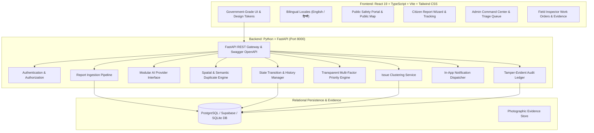

# CivicSutra AI — Local Problem Intelligence & Response Platform

> **Full Platform Name**: AI-Powered Local Problem Intelligence & Response Platform  
> **Tagline**: *“Many Reports. One Connected Understanding. Smarter Action.”*  
> **Core Message**: *“Understand. Connect. Prioritize. Support Action.”*

---

## 1. Executive Summary

**CivicSutra AI** is an AI-powered municipal intelligence and civic problem response platform designed to transform fragmented, isolated citizen reports into connected, location-aware, evidence-supported civic intelligence.

When citizens report local hazards—such as potholes, overflowing waste, or waterlogging—the platform cross-references geographic proximity (Haversine formula), semantic description similarity (NLP token overlap and civic synonyms), and category alignment. It suggests candidate duplicates, assists human reviewers in grouping related reports into unified issue clusters, calculates a transparent multi-factor priority score, and tracks resolution across municipal units and field teams.

---

## 2. System Architecture & Modules



---

## 3. Database Design (11 Relational Entities)

The database schema is defined in [`backend/database/schema.sql`](file:///C:/Users/DIPTI%20YADAV/.gemini/antigravity/scratch/civicsutra-ai/backend/database/schema.sql) and is fully compatible with **PostgreSQL**, **Supabase**, and local **SQLite**:

1. **`users`**: User identity, roles (`CITIZEN`, `ADMIN`, `FIELD_TEAM`), language preferences, account status.
2. **`reports`**: Public reference ID (`CS-2026-XXXX`), GPS coordinates, address, landmark, photo evidence, category, status, privacy flags.
3. **`ai_analysis`**: Structured evidence extraction, predicted category, confidence score, model provider, and diagnostic details.
4. **`duplicate_suggestions`**: Candidate match pairs, Haversine distance, semantic NLP similarity %, image similarity, category agreement, reviewer decision status.
5. **`issue_clusters`**: Multi-report cluster groups, center coordinates, combined priority score, assigned department, reviewer notes.
6. **`cluster_reports`**: Many-to-many junction associating individual reports to clusters without deleting original submissions.
7. **`status_history`**: Complete state transition ledger tracking previous status, new status, actor, note, and timestamp.
8. **`assignments`**: Work orders dispatched to specific municipal divisions and field inspectors.
9. **`notifications`**: Citizen alerts for status changes, cluster associations, and progress notes.
10. **`feedback`**: Citizen ratings (1–5 stars) and resolution quality feedback.
11. **`audit_logs`**: Immutable, tamper-evident log of all administrative actions.

---

## 4. Key AI & Intelligence Capabilities

### A. Explainable Duplicate Detection
- **Geographic Proximity**: Computes great-circle distance using the spherical Haversine formula ($R=6371\text{ km}$).
- **Semantic Text Matching**: Tokenizes English and Hindi Romanized descriptions, eliminates stop words, and clusters civic synonyms (*pothole*, *crater*, *cavity*, *gaddha*, *toota*).
- **Calibrated Multi-Signal Score**:
  $$\text{Match Confidence} = (\text{Spatial Score} \times 0.40) + (\text{Semantic Overlap} \times 0.35) + (\text{Category Match} \times 0.15) + (\text{Image Evidence} \times 0.10)$$
- **Human-in-the-Loop Safeguard**: AI generates suggestions; authorized reviewers must certify each match (*Confirm Corroborating Report* vs. *Confirm Independent Issue*).

### B. Modular AI Provider Interface
- Supports live LLM providers (**Google Gemini**, **OpenAI**) via backend environment variables.
- Falls back gracefully to deterministic **Demo AI Analysis** (`demo-rule-based-nlp`) when running without external API keys.
- Clearly labels demo outputs as `"is_demo_analysis": true` in compliance with responsible AI governance.

### C. Transparent Multi-Factor Priority Engine ($0–100$)
Calculates an auditable triage score combining six documented factors:
1. **Hazard Severity (30 pts)**: Road safety risk (potholes=26, waterlogging=28, water leaks=24, waste=20).
2. **Corroborating Report Volume (20 pts)**: Capped logarithmic scaling (1 report=6 pts, 2=12, 3=16, 4+=20).
3. **Sensitive Facility Proximity (20 pts)**: Proximity boost if adjacent to schools, hospitals, transit terminals, or clinics.
4. **Unresolved Duration (15 pts)**: Incremental escalation for reports remaining unaddressed over multiple days.
5. **Recurrence (10 pts)**: Repeat infrastructure failure history.
6. **Evidence Quality (5 pts)**: Verified photo evidence clarity.

Every score features an interactive modal detailing the mathematical formula and factor breakdown.

---

## 5. Pre-Seeded Demonstration Personas

| Role | Persona Name | Email | Purpose |
| :--- | :--- | :--- | :--- |
| **Citizen** | Aarav Sharma | `citizen@civicsutra.org` | Submit grievances, use voice dictation, track timeline |
| **Authority / Admin** | Dr. Rajesh Kumar | `admin@civicsutra.org` | Triage intake, review duplicates, manage clusters |
| **Field Team** | Pooja Verma | `field@civicsutra.org` | Inspect assigned work orders, upload resolution evidence |

*A one-click persona switcher is embedded in the top navigation bar for seamless testing across all three roles.*

---

## 6. Getting Started & Running Locally

### Prerequisites
- Node.js (v18+) & npm
- Python (v3.10+)

### Step 1: Start the FastAPI Backend

```bash
cd backend
py -m uvicorn app.main:app --host 127.0.0.1 --port 8000 --reload
```
- API Base: `http://127.0.0.1:8000`
- Interactive OpenAPI Swagger UI: **`http://127.0.0.1:8000/docs`**
- Interactive ReDoc Documentation: **`http://127.0.0.1:8000/redoc`**

### Step 2: Start the React Frontend

```bash
cd client
npm install
npm run dev
```
- Web Application: **`http://localhost:5173`** (proxies `/api` to port 8000)

### Step 3: Run the Automated Test Suite

```bash
cd backend
py -m pytest tests/test_civicsutra.py -v
```

All 15 automated test cases verify authentication, report submission, validation, duplicate detection, clustering, status transitions, priority scoring, and audit logging.

---

## 7. QA Verification Checklist (Scenarios 1–20)

- [x] **1. Citizen Authentication**: Sign-in via demo persona or email.
- [x] **2. Valid Report Submission**: Ingests title, description, category, GPS coordinates, and photo evidence.
- [x] **3. Validation Error Handling**: Rejects missing required fields with clear feedback.
- [x] **4. Missing Photo Handling**: Submissions without photos succeed cleanly with lower evidence score.
- [x] **5. Report Persistence**: Stored reports remain available across page refreshes and server restarts.
- [x] **6. AI Resilience**: Fallback to deterministic Demo AI Analysis if external API is unconfigured.
- [x] **7. Duplicate Detection**: Correctly flags corroborating reports within 45m on MG Road.
- [x] **8. Spatial Separation**: Distant reports (11 km away) are never suggested as duplicates.
- [x] **9. Category Isolation**: Nearby but different categories (pothole vs streetlight) are not merged.
- [x] **10. Duplicate Review Workflow**: Reviewer can confirm match or mark as independent issue.
- [x] **11. Server-Side State Validation**: Invalid status jumps are rejected server-side.
- [x] **12. Issue Clustering**: Multi-report clusters link member submissions without deleting originals.
- [x] **13. Deterministic Priority**: Generates reproducible score with full factor breakdown modal.
- [x] **14. Status History**: Every transition appends an entry to the auditable status history.
- [x] **15. Real Database Counts**: Dashboard KPI cards dynamically reflect stored database records.
- [x] **16. Search & Filters**: Category and status filters work across all views.
- [x] **17. Map & Fallback**: Interactive map displays pins, clusters, popups, and click-to-pin coordinate picker.
- [x] **18. Responsive Design**: Layout adapts across desktop, tablet, and mobile drawers.
- [x] **19. Bilingual Support**: English and हिन्दी toggle updates all navigation and interface labels.
- [x] **20. Privacy Safeguards**: Public views strictly mask citizen names, phone numbers, and exact home addresses.
